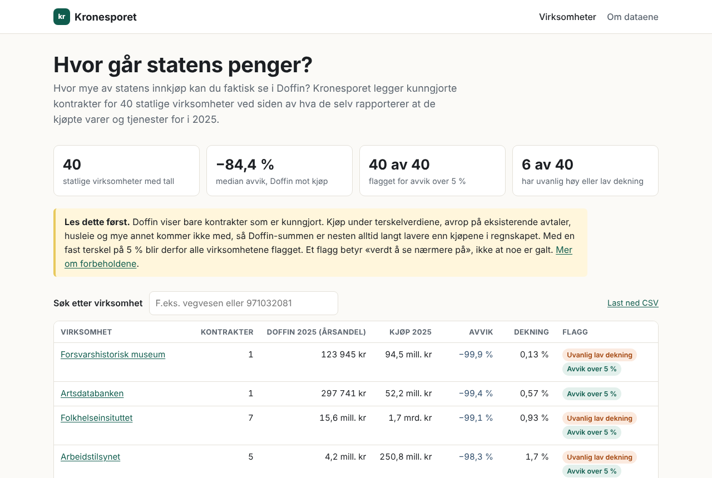
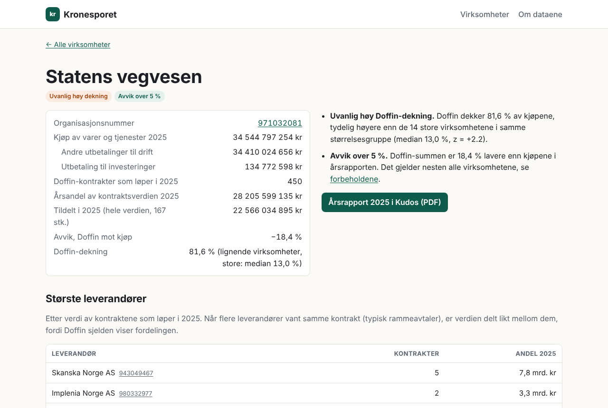

# Kronesporet

**Åpenhet om statens pengebruk.** Kronesporet kobler kunngjorte kontrakter i Doffin mot hva
statlige virksomheter selv rapporterer at de kjøper for, og viser hvor mye av innkjøpene som
faktisk er synlige for offentligheten.

[Nettsiden](https://kronesporet.no/) ·
[Om dataene og metoden](https://kronesporet.no/om.html) ·
[Last ned dataene (CSV)](docs/data/virksomheter.csv) ·
[Endringslogg](CHANGELOG.md)



## Hva Kronesporet viser

For hver statlig virksomhet med årsrapport i Kudos:

- **Kjøp av varer og tjenester** fra årsrapportens oppstilling av artskontorapporteringen
  (drift og investering, uten lønn, tilskudd og finans).
- **Doffin-kontraktene** der virksomheten er kjøper, med leverandør, periode og verdi.
  Verdien er fordelt over årene kontrakten løper.
- **Avvik og dekning:** hvor stor del av kjøpene som finnes igjen i Doffin, og om
  virksomheten skiller seg ut fra lignende virksomheter.
- **Flagg** for avvik over 5 % og for uvanlig høy eller lav Doffin-dekning.

Første versjon dekker 40 statlige virksomheter for regnskapsåret 2025, med 1 622 kontrakter og
leverandørene deres.

<details>
<summary>Skjermbilde av en virksomhetsside</summary>



</details>

## Datakilder og lisens

| Kilde | Hva vi bruker | Utgiver |
|---|---|---|
| [Doffin](https://doffin.no) | Kunngjøringer om tildelte kontrakter: kjøper, tittel, verdi, periode, leverandører | Digitaliseringsdirektoratet (Digdir) |
| [Kudos](https://kudos.dfo.no) | Årsrapporter fra statlige virksomheter (oppstilling av artskontorapportering) | Direktoratet for forvaltning og økonomistyring (DFØ) |
| [Statsregnskapet](https://statsregnskapet.dfo.no) | Rådata fra bevilgningsregnskapet (xlsx): kjøp per virksomhet og artskonto | DFØ |
| [Enhetsregisteret](https://data.brreg.no) | Underenheter og organisasjonsledd, så kunngjøringer fra f.eks. politidistriktene føres på Politiet | Brønnøysundregistrene |

Inneholder data under [Norsk lisens for offentlige data (NLOD 2.0)](https://data.norge.no/nlod/no/2.0),
tilgjengeliggjort av Digdir og DFØ. Kronesporet er ikke tilknyttet Digdir eller DFØ.

## Kom i gang

Krever Python 3.10 eller nyere, `requests` og `pdftotext` (poppler-utils) for å lese årsrapportene.

```bash
pip install -r requirements.txt

# 1. Hent Doffin-kontrakter og kjøp fra årsrapportene, koble og flagg
python scripts/run_phase1.py --year 2025 --kudos

# 2. Hent leverandørene for kontraktene som løper i 2025 (ca. en halvtime)
python scripts/fetch_winners.py --year 2025

# 3. Bygg nettsiden til docs/ (eller eksporter tallene og la GitHub Actions bygge, se under)
python scripts/build_site.py --db data/offentlig_forbruk.db --out docs
```

`build_site.py` tar med alle årene i databasen. Siste år blir forsiden, de andre årene får
egne sider (`docs/ar/<år>.html`), og hver virksomhet får en tabell over utviklingen. Velg år med
`--year 2024 2025`.

### Rådata fra statsregnskapet (anbefalt)

DFØ publiserer «Rådata <måned> <år> (bevilgningsregnskap)» som xlsx på
statsregnskapet.dfo.no/last-ned: én rad per virksomhet (orgnr), kapittel, post og
artskonto, beløp hittil i år. Desember gir hele året. Flere filer kan gis samtidig,
og hver fil blir sitt år.

```bash
python scripts/run_phase1.py --year 2025 --kudos --statsregnskap \
    data/raadata_desember_2023_bevilgningsregnskap.xlsx \
    data/raadata_desember_2024_bevilgningsregnskap.xlsx \
    data/raadata_desember_2025_bevilgningsregnskap.xlsx
```

- Kjøp av varer og tjenester = artskonto 40–45 og 61–69 (varer, tjenester, husleie,
  konsulenter m.m.), 70–77 unntatt 71 (drift ellers) og 47–49 (investeringer).
  Lønn, tilskudd, overføringer og finans er holdt utenfor.
- Filene dekker de bruttobudsjetterte virksomhetene (omtrent 160 per år).
  Nettobudsjetterte virksomheter (universiteter m.fl.) står bare som tilskudd og er ikke med.
  Med `--kudos` hentes kjøpstallene deres fra årsrapportene i stedet (se under);
  virksomheter som finnes i rådata hentes ikke fra Kudos.
- Doffin-tildelinger hentes for alle regnskapsårene pluss `--history` år før det første.
- Mange virksomheter kunngjør på underenheter eller organisasjonsledd: politidistriktene og
  Politiets fellestjenester for Politiet, FLO for Forsvaret. Disse slås opp i Enhetsregisteret
  (tabellen `orgnr_parent`, `src/collectors/brreg.py`) og føres på virksomheten i regnskapet.
  En underenhet som selv står i regnskapet (f.eks. HELFO under Helsedirektoratet) beholder sitt eget orgnr.

Helseforetakene (de fire RHF-ene og foretakene de eier) står i `site-data/helseforetak.csv`.
`scripts/update_site_data.py` henter underenhetene deres (sykehus og avdelinger) fra Enhetsregisteret,
kontraktene fra Doffin og årsregnskapene for de siste tre årene fra Regnskapsregisteret
(`src/collectors/foretak.py`). Nettsiden viser dem på `helseforetak.html` og `docs/helseforetak/<orgnr>.html`
med driftskostnader utenom lønn som sammenligningstall. De flagges ikke, fordi tallet ikke er det samme som
kjøp av varer og tjenester i statsregnskapet.

Kommunene og fylkeskommunene hentes også av `scripts/update_site_data.py` (`src/collectors/kostra.py`):
kjøpene fra KOSTRA (SSB-tabell 13551, 13552, 13547 og 13548, konserntall: kjøp av varer og tjenester, kjøp
som erstatter egen produksjon og investeringer) fra 2020, og orgnr fra Enhetsregisteret. For årene før 2024
hentes de gamle kommunenumrene fra SSBs klassifikasjon (KLASS 131); Ålesund og Haram (delt i 2024) og de
sju nye fylkeskommunene har tall fra 2024. Kjøpere i Doffin som ikke er kjent, slås opp oppover i Enhetsregisteret
(`brreg.resolve_upward`), og etater, bydeler og kommunale foretak føres på kommunen. Tidligere kommuner og
fylkeskommuner og nedlagte kommunale foretak føres på kommunen de ble en del av (`kostra.successors`, ut fra
navnet og kommuneendringene i KLASS). Orgnr som er slått opp uten treff, huskes i tabellen `orgnr_checked`;
`--recheck-buyers` slår dem opp på nytt etter nye regler. Nettsiden viser dem på `kommuner.html` og
`docs/kommune/<orgnr>.html`, med dekningen sammenlignet med kommuner av lignende størrelse.

Statlige selskaper (statsforetak, statlig eide aksjeselskaper, Norges Bank og andre enheter SSB regner til
staten) finnes blant kjøperne i Doffin ut fra institusjonell sektor i Enhetsregisteret
(`src/collectors/selskaper.py`, tabellen `selskaper`). Underenhetene kobles som for virksomhetene, og
årsregnskapene hentes fra Regnskapsregisteret til `foretak_regnskap`. Nettsiden viser dem på `selskaper.html`
og `docs/selskap/<orgnr>.html`.

Med leverandører i databasen får nettsiden også en leverandøroversikt (`leverandorer.html`) og én
side per leverandør med organisasjonsnummer (`docs/leverandor/<orgnr>.html`) med kontraktene på
tvers av statlige kjøpere.

Alle steg skriver til `data/offentlig_forbruk.db` (SQLite). Rå Doffin-kunngjøringer caches i
`data/doffin_cache/`, så nye kjøringer går raskt. Doffin kalles med minst 1,2 sekunder mellom
hvert kall.

### Prosjektstruktur

```
src/collectors/   innsamling: Doffin, årsrapporter i Kudos, DFØs månedsrapport
src/analysis/     kobling, årsfordeling, avvik og dekningsgrad
src/web/          nettsiden: data.py leser SQLite, build.py lager HTML, assets/ er CSS og JS
scripts/          run_phase1.py, fetch_winners.py, build_site.py, export_site_data.py, check_site.py
site-data/        tallene nettsiden bygges fra (SQL-tekst)
docs/             ferdig bygget nettside (publiseres som den er)
```

## Metode

### Kobling

Regnskapet har ikke leverandører, så koblingen går på **kjøper**: organisasjonsnummeret til
kjøperen i Doffin mot virksomheten som har levert årsrapporten. Avviket er
(Doffin − kjøp) / kjøp, og virksomheter med avvik over 5 % blir flagget
(`flag_type = 'doffin_avvik'`).

### Årsfordelt kontraktverdi

Verdien i Doffin gjelder hele kontraktsperioden, ofte en rammeavtale over flere år, mens
regnskapet viser ett år. Hver kontrakt fordeles derfor jevnt over perioden den løper, og et
regnskapsår sammenlignes med summen av årsandelene til alle kontrakter som løper det året, også
de som ble tildelt tidligere (`src/analysis/annualize.py`, tabellen `doffin_contract_years`).

Kontraktsperioden leses fra kunngjøringen, i denne rekkefølgen:

1. start- og sluttdato (`datoer`)
2. «Varighet» / «Varighet, År» (`varighet`), regnet fra startdato eller publisering
3. fritekst som «2+1+1 år» eller «total varighet inntil 4 år» (`tekst`)
4. standard når ingenting er oppgitt: rammeavtaler 48 måneder (lovens maksimum, og medianen
   blant rammeavtaler med oppgitt periode), andre kontrakter 24 måneder (medianen blant dem
   med oppgitt periode)

Fornyelser («Maksimal fornyelse: 2») regnes som 12 måneder hver, men ikke ut over 48 måneder
totalt. Verdien er tildelt total for prosedyren, ellers rammeavtalenes maksimale verdi, ellers
summen av vinnernes verdier. Siden kontrakter tildelt tidligere år også teller, henter
`run_phase1.py` tildelinger 8 år bakover (`--history`) for virksomhetene som har regnskapstall.

### Doffin-dekning mot lignende virksomheter

**Doffin-dekning** = årsandel av Doffin-kontrakter / kjøp av varer og tjenester
(`src/analysis/coverage.py`, tabellen `doffin_coverage`). Hver virksomhet sammenlignes med
virksomheter i samme størrelsesgruppe etter kjøp (små, mellomstore og store per år). Avstanden
måles som robust z-verdi på log10(dekning) mot gruppens median og MAD. |z| > 2 et år er et avvik.

Ett år alene kan skyldes en enkelt stor rammeavtale, så flagget krever at avviket varer:

| Kategori (`doffin_coverage.category`) | Regel | I `flags` |
|---|---|---|
| `flagg` | avvik samme vei i minst 2 av de siste 3 årene, med året selv blant dem | `doffin_dekning`, warning |
| `observasjon` | avvik bare dette året | `doffin_dekning_observasjon`, info |
| `tilskudd` | dekning over 100 %, og tilskuddene ut av staten (artskonto 870–876, 878) er minst like store som Doffin-andelen | ingen |
| `avtaler_for_andre` | dekning over 100 % ellers: avtaler for andre virksomheter, eller kjøp som føres utenfor kjøp av varer og tjenester | ingen |

- **Høy dekning over 100 %** har som regel en kjent forklaring og blir en kategori, ikke et flagg.
  Samferdselsdepartementet kunngjør flyruter og togtrafikk, men betaler dem som tilskudd til foretak.
  DFØ og DSS inngår avtaler som andre virksomheter bruker.
- **Høy dekning under 100 %:** kontraktverdiene er tak i rammeavtaler som ikke brukes fullt ut.
- **Lav dekning:** lite er kunngjort sammenlignet med kjøpene, for eksempel mye kjøp under
  terskelverdiene eller via andres avtaler.
- Det første året i databasen og et år uten året før kan bare gi observasjoner.
  `--persist-window` og `--persist-min` endrer regelen.

### Leverandører

Leverandørene er vinnerne slik de står i kunngjøringen (`awardedNames`), med
organisasjonsnummer fra virksomhetslisten i kunngjøringen når det er oppgitt (tabellen
`doffin_winners`). Rollene i virksomhetslisten brukes ikke. Når en kunngjøring har flere
virksomheter, får alle virksomhetene alle rollene, også kjøperen og klageorganet. Når flere
leverandører vant samme kontrakt, deles verdien likt mellom dem i oversikten over de største
leverandørene.

## Forbehold

- **Doffin dekker bare en del av kjøpene.** Kjøp under terskelverdiene, avrop på eksisterende
  rammeavtaler (også Statens innkjøpssenters fellesavtaler), husleie og kjøp via andre
  virksomheter kunngjøres ikke. Doffin-summen blir derfor som regel mye lavere enn kjøpene, og
  5 %-terskelen flagger nesten alle. Et flagg betyr «verdt å se nærmere på», ikke at noe er galt.
- **Kontraktverdier er anslag.** For rammeavtaler er verdien ofte et tak, ikke det som faktisk
  blir kjøpt. Kontrakter uten oppgitt periode får en antatt varighet.
- **Ikke alle virksomheter er med.** Statlige selskaper er verken i statsregnskapet eller har
  årsrapport i Kudos. Helseforetakene og kommunene er heller ikke i statsregnskapet, men har egne sider
  med tall fra Regnskapsregisteret og KOSTRA (se under). Statens direkte økonomiske engasjement (SDØE)
  står i regnskapet, men kunngjør ikke i Doffin.
- **Feil i kildene følger med.** Navn og tall vises slik de står i Doffin og årsrapportene.

<details>
<summary><strong>Flere valg for <code>run_phase1.py</code></strong></summary>

#### Med statsregnskapet som CSV

```bash
# Last ned CSV manuelt fra https://statsregnskapet.dfo.no/last-ned
python scripts/run_phase1.py --year 2025 --statsregnskap data/statsregnskap_2025.csv
```

`--col-year/--col-orgnr/--col-name/--col-amount` hvis kolonnenavnene i CSV-en ikke gjenkjennes
automatisk (se `src/analysis/join_and_flag.py`). `--artskonto-prefix 6 7` tar bare med utvalgte
artskontoer.

#### Med DFØs månedsrapport (xlsx)

Statsregnskapet publiserer også «Utgifter til staten <måned> <år>» som xlsx (hittil i år, per
kapittel og post, uten orgnr):

```bash
python scripts/run_phase1.py --year 2026 --to-month 8 \
    --statsregnskap data/utgifter_til_staten_august_2026.xlsx
```

- `--to-month 8` henter bare Doffin-kunngjøringer januar–august, så periodene matcher.
- `--posts 1-49` (standard) tar med drifts- og investeringsposter; 50–99 er overføringer.
- Kapittelnavn kobles til orgnr via Doffin-kjøpere og Enhetsregisteret. Treffene ligger i
  tabellen `kapittel_orgnr` og kan rettes for hånd med `kilde = 'manuell'`.

#### Årsrapportene i Kudos

`--kudos` henter kjøp fra årsrapportene i Kudos (ingen nøkkel): «Andre utbetalinger til drift» +
«Utbetaling til investeringer». Med `--skip-collect` brukes Doffin-dataene som allerede ligger i
databasen. Sammen med `--statsregnskap` hentes bare virksomheter som mangler i regnskapsfilene.

- Nettobudsjetterte virksomheter (universiteter) har ikke artskontorapportering. For dem brukes
  SRS-regnskapets «utbetalinger for kjøp av varer og tjenester» (KS.12, ellers «Andre
  driftskostnader», RE.10) og investeringer (KS.17).

#### Andre valg

- `--no-details` henter bare søketreff (under ett minutt) og bruker anslått verdi. Uten flagget
  hentes tildelt verdi fra hver kunngjøring, som tar omtrent en time for et helt år.
- `--max-notices 50` for en rask prøvekjøring.
- `--no-annualize` gir den gamle sammenligningen (hele kontraktsverdien i publiseringsåret).
- `--framework-months` og `--contract-months` endrer standardvarighetene.
- `--z-threshold` og `--peer-bands` endrer grensen og antall grupper for dekningsflagget,
  `--persist-window` og `--persist-min` hvor mange år avviket må vare.

</details>

## Automatisk bygging

Tallene nettsiden bygges fra ligger som tekst i `site-data/kronesporet.sql`. GitHub Actions
(`.github/workflows/nettside.yml`) bygger `docs/` på nytt og committer resultatet når
`site-data/`, `src/web/` eller byggeskriptet endres på `main`. På pull requests bygges siden
og alle interne lenker sjekkes.

Slik oppdateres tallene etter en ny kjøring:

```bash
python scripts/export_site_data.py --db data/offentlig_forbruk.db   # skriver site-data/kronesporet.sql
git add site-data/kronesporet.sql && git commit -m "Nye tall" && git push
```

### Månedlig oppdatering

`.github/workflows/oppdatering.yml` kjører den 20. hver måned (og når du trykker «Run workflow» under
Actions → Oppdatering). Den tar utgangspunkt i `site-data/kronesporet.sql` og gjør dette
(`scripts/update_site_data.py`):

1. Henter nye kontraktstildelinger i Doffin for virksomhetene og underenhetene deres, med
   kontraktsperiode og vinnere. Kunngjøringer som allerede er lagret, hentes ikke på nytt.
2. Tar inn nye rådatafiler fra statsregnskapet som ligger i `site-data/raadata/`. En nyere måned
   erstatter den forrige for samme år, og filer som allerede er lastet inn, hoppes over.
3. Regner ut årsfordeling, avvik og Doffin-dekning på nytt, bygger `docs/` og committer begge deler.

Oppdateringen holder seg til virksomhetene som allerede er på nettsiden. Nye virksomheter trenger
Doffin-historikk og underenheter fra Enhetsregisteret, og legges til med `scripts/run_phase1.py`.

statsregnskapet.dfo.no stenger for kall fra skyen, også fra GitHub Actions, så rådata må lastes ned i
en vanlig nettleser fra https://statsregnskapet.dfo.no/last-ned («Rådata <måned> <år>
(bevilgningsregnskap)»). Last filen opp på GitHub under `site-data/raadata/` (Add file → Upload files).
Da starter oppdateringen med en gang. Desemberfilen gir hele året, og det holder å laste opp den.
Månedsfilene gir ferskere tall for året som går.

Lokalt går det også an å gi inn filen direkte:

```bash
python scripts/update_site_data.py --raadata ~/Nedlastinger/raadata_september_2026_bevilgningsregnskap.xlsx
```

## Publisering

`docs/` er en ferdig bygget statisk nettside, så det trengs ingen byggekommando.

- **GitHub Pages:** Settings → Pages → Source «Deploy from a branch» → `main` og `/docs`.
  Krever offentlig repo på gratisplanen.
- **Netlify:** «Add new site» → «Import an existing project» → velg repoet. `netlify.toml`
  setter publiseringsmappe `docs` og tom byggekommando.
- **Cloudflare Pages:** Workers & Pages → Create → Pages → koble til repoet, framework «None»,
  tom byggekommando og «Build output directory» `docs`.

**Eget domene (kronesporet.no).** Nettsiden bygges med `--cname kronesporet.no` (GitHub Actions
gjør det automatisk), som skriver `docs/CNAME` og bruker https://kronesporet.no/ i canonical-lenker,
Open Graph og sidekartet. DNS hos domeneregistraren:

| Navn | Type | Verdi |
|---|---|---|
| `kronesporet.no` | A | 185.199.108.153, 185.199.109.153, 185.199.110.153, 185.199.111.153 |
| `kronesporet.no` | AAAA | 2606:50c0:8000::153, 2606:50c0:8001::153, 2606:50c0:8002::153, 2606:50c0:8003::153 |
| `www` | CNAME | `markemus-byte.github.io` |

Når DNS peker riktig, viser Settings → Pages «DNS check successful», og etter at sertifikatet er
utstedt (vanligvis innen en time) krysses «Enforce HTTPS» av. På Netlify og Cloudflare legges
domenet inn i deres kontrollpanel i stedet.

## Opphavsrett

© 2026 Markemus-byte / Kronesporet. Alle rettigheter forbeholdt.

Dataene fra Doffin og Kudos er underlagt NLOD 2.0 og kan gjenbrukes med kildehenvisning som
beskrevet over.
